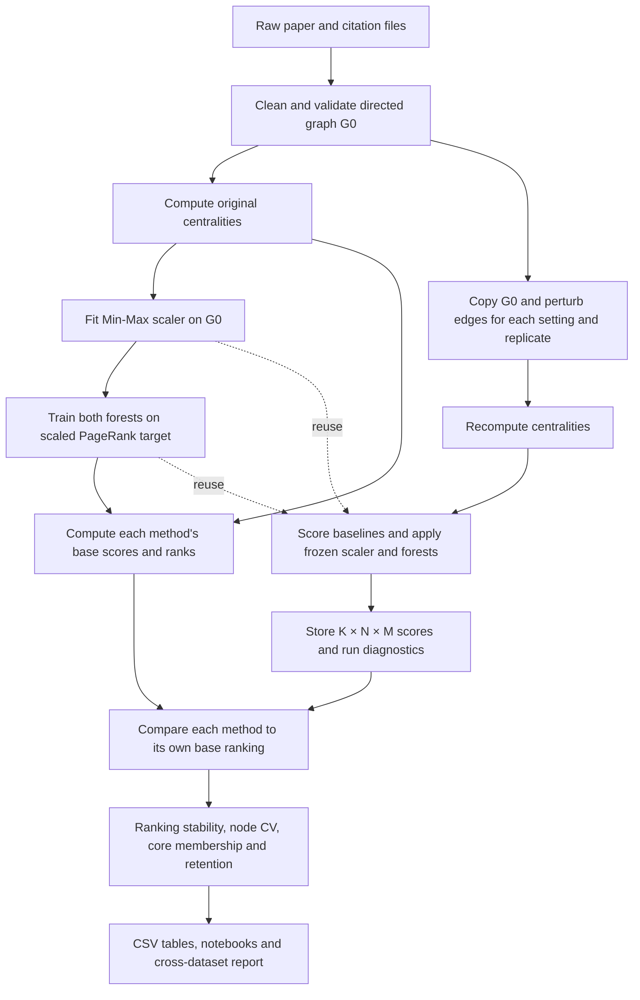

# Phase B technical research report

Evidence base for Chapters 3 and 4 of *Stability and Structural Validity in Citation Networks*. Repository snapshot: `niran` at `e6fe82e`, inspected 25 November 2026. The six saved experiment configurations support a conditional result. The primary forest preserves its top 10% better than PageRank under edge addition on PubMed-Diabetes. This advantage is absent on Cora and CiteSeer and does not establish overall superiority against individual centralities.

Use Sections 1–7 and 10–11 for methods and implementation. Use Sections 8–9, 12 and Appendix A for results and discussion. **Implemented** refers to a code path. **Completed** refers to a run supported by saved artifacts and the project log. **Planned** refers to the Phase A design or a proposed extension. Explanations attributed to graph connectivity, ties or tree saturation should be presented as interpretations unless directly measured. Numerical comparisons below are descriptive.

## 1. Research pipeline and architecture



| Stage | Inputs and operation | Outputs and consumers |
| --- | --- | --- |
| Dataset preparation | `src/data.py`, `clean_dataset()`, `save_dataset()`, `load_clean_graph()`. Parse IDs, labels and citations, filter as described in §2, reload directed graph. | `nodes.csv`, `edges.csv`, `cleaning_log.json`. Graph (G_0) anchors all model fits and perturbations. |
| Structural representation | `src/features.py:compute_features()` and `src/scaling.py`. Compute an ordered per-paper centrality matrix, fit and apply one scaler. | `features_raw.csv`, `features_scaled.csv`, `scaler.joblib`. IDs remain string keys. |
| Model fitting | `src/model.py:train_model()`, `holdout_check()`, `load_or_train()`. Train two forest variants per configuration. | Model caches and `model_report.json`. Separate hold-out models supply diagnostics. |
| Base ranking | `src/ranking.py:base_scores()`, `to_ranking()`, and `scripts/run_pipeline.py:base_ranking()`. Rank original scores with average ties. | Processed `base_scores.csv` (scaled) and `base_ranking.csv`. Runner asserts equality to ranks from natural-unit scoring. |
| Perturbation and inference | `src/perturb.py` and `src/experiment.py:run_all()`, `run_setting()`, `score_graph()`. Recompute centralities on every copy and apply fixed scaler and estimators. | `results/<run>/runs/` contains original natural-unit scores, setting NPZ arrays indexed by repetition, paper and method, and per-graph diagnostics. |
| Analysis and communication | `src/analysis.py`, `src/stability.py`, `src/core.py`, notebooks 07–08 and `scripts/build_report.py`. | Per-run and aggregate CSVs, notebook figures and the compiled HTML/PDF report. `app/app.py` is a separate interactive single-run demonstration with saved aggregate plots and a static HTML export. |

Persisted arrays carry ordered paper IDs and method IDs. `run_setting()` reindexes scores to the original node order before writing. `evaluate_all()` asserts exact agreement between stored paper IDs and base-score index before comparing rankings. Each method is assessed against its own original ordering.

## 2. Datasets and preprocessing

All records represent scientific papers, with a directed edge from citing paper to cited paper. Topic labels remain metadata and are excluded from the structural predictors and target. The official [LINQS dataset catalog](https://linqs.org/datasets/) describes the datasets and supplies downloads. Archive links below identify the public source locations. The repository records the supplied/extracted inputs used by this project and does not establish byte identity with a fresh download.

| Dataset and source | Raw nodes / edges | Clean nodes / edges | Labels and reason for use |
| --- | ---: | ---: | --- |
| [PubMed-Diabetes archive](https://linqs-data.soe.ucsc.edu/public/Pubmed-Diabetes.tgz), `data/raw/Pubmed-Diabetes.*` | 19,717 / 44,338 | 19,717 / 44,324 | Diabetes publications, labels 1/2/3 with 4,103/7,875/7,739 records. The team used the dataset supplied for the project as the main study (D1). The parser discards 500 TF-IDF word features and ignores summary fields. |
| [Cora archive](https://linqs-data.soe.ucsc.edu/public/lbc/cora.tgz), `data/raw/cora/` | 2,708 / 5,429 | 2,708 / 5,274 | Machine-learning papers in seven topics (Case Based, Genetic Algorithms, Neural Networks, Probabilistic Methods, Reinforcement Learning, Rule Learning, Theory). Originally the preliminary Phase A choice, then included as a cross-dataset check in response to lecturer feedback (D20). |
| [CiteSeer document-classification archive](https://linqs-data.soe.ucsc.edu/public/lbc/citeseer.tgz), `data/raw/citeseer/` | 3,312 / 4,732 | 3,264 / 4,535 | Scientific papers labeled AI, Agents, DB, HCI, IR or ML. Added as another cross-dataset check under D20. Repository records no more specific independent rationale for choosing CiteSeer. |

PubMed node and edge readers skip two header lines and parse the first citation endpoint as the source. In Cora and CiteSeer, `scripts/prepare_linqs_raw.py` extracts IDs and class labels from `.content`, retains `.cites` and the archive README, and discards word attributes. The README specifies that the second endpoint cites the first. `load_linqs()` reverses the file-field order to build `source → target`.

| Dataset | Duplicate edges removed | Self-loops removed | Unknown-endpoint edges removed | Cycle-breaking edges removed | Isolates removed | Final weak components / nontrivial SCCs |
| --- | ---: | ---: | ---: | ---: | ---: | --- |
| PubMed | 0 | 3 | 0 | 11 | 0 | 1 / 0 |
| Cora | 0 | 0 | 0 | 155 | 0 | 78 / 0 |
| CiteSeer | 0 | 124 | 17 | 56 | 48 | 390 / 0 |

All runs first deduplicate ordered edge pairs and remove self-loops. PubMed resolves reciprocal pairs before the known-endpoint check. It keeps the edge from higher to lower numeric PubMed ID and deletes the reverse edge. D5 reports that 89.6% of observed citations go from higher to lower ID. That figure measures agreement with the ID convention, with no date-based ground truth. Cora and CiteSeer filter unknown endpoints first. `break_citation_cycles()` uses igraph to find each nontrivial strongly connected component (SCC) and solves a minimum feedback arc set by integer programming (`method="ip"`) within each SCC. Cora had 151 mutual pairs in a graph with 122 nontrivial SCCs, and CiteSeer had 55 mutual pairs and 47 SCCs. Equally minimal deletions can produce different cleaned graphs. The chosen edges carry no verified chronological interpretation.

The final filter removes papers with neither incoming nor outgoing citations and retains all remaining weak components. `check_graph()` logs node/edge counts and connectivity without altering the data. Initial structural checks and tests support acyclicity after self-loop removal. `perturb.time_order()` creates a fixed lexicographic topological order on each cleaned DAG. The order extends the retained citations and arbitrarily resolves incomparable papers. No publication dates are used. Perturbation preserves all cleaned papers, including any isolates created by edge removal. Sources are the three full-run `data/processed[/cora|/citeseer]/cleaning_log.json` files, `docs/cleaning_report.md`, D3/D5/D18/D20 and `tests/test_cleaning.py`, `tests/test_datasets.py`.

## 3. Centrality feature extraction

Let (N) be the number of retained papers. Graphs are unweighted. NetworkX handles the graph, total degree, PageRank and core number. `_to_igraph()` maps ordered paper IDs to integer vertices once per feature computation and shares the directed conversion between the two path-based measures.

| Measure | Exact implementation |
| --- | --- |
| Degree | `(d_in(v) + d_out(v)) / (N − 1)` via `nx.degree_centrality` for N > 1. Isolates in multi-node graphs score zero. Reciprocal arcs contribute in both directions. |
| Betweenness | Sum `σ_st(v) / σ_st` over ordered reachable pairs excluding v, where σ counts shortest paths. Divide exact directed igraph betweenness by `(N − 1)(N − 2)` for N > 2 and by one otherwise. Unreachable pairs contribute zero. |
| Closeness | Incoming Wasserman–Faust closeness is `(r / Σᵤ d(u,v)) × (r / (N − 1))`. Here r counts other papers u that can reach v and the sum runs over those papers. igraph supplies the first factor and incoming neighborhood size minus one supplies r. Score zero if r = 0 or N ≤ 1. |
| PageRank | Stationary probability on the directed graph, `π = 0.85 Pᵀπ + 0.15 · 1/N` componentwise, where P is the row-stochastic outgoing transition matrix. Non-dangling rows distribute mass uniformly across outgoing citations and dangling rows distribute uniformly across all nodes. `nx.pagerank(alpha=0.85)` uses the other pinned NetworkX defaults, including `max_iter=100`, `tol=1e-6` and a uniform initial vector. No explicit weights or personalization are supplied. |
| k-core | Largest integer (k) for which the paper belongs to a subgraph of minimum undirected degree (k). `nx.Graph(g)` collapses reciprocal arcs to one simple edge and the code removes self-loops before `nx.core_number`. The returned feature is the integer core number, zero for isolates. |

Notebook 02 and `src/features.py` define the original table. `FEATURE_SET=no_closeness` skips the closeness computation and removes its column from all downstream tables. D4 records exact NetworkX betweenness at 161 s versus under 1 s with igraph in the measured case. Sampling at (k=500) reached only Spearman 0.55 against the exact scores and found 535 of 1,807 nonzero nodes, so the study uses exact betweenness. D11 reports roughly 20 s versus 1.5 s for closeness on cyclic additions in an earlier check. The experiment caches complete score arrays. It recomputes features on every newly scored graph. The app separately caches interactive graph settings and before/after feature tables.

## 4. Machine learning methodology

| Variant | Full inputs | Inputs in the no-closeness run | Role |
| --- | --- | --- | --- |
| `rf_without_pagerank` | Degree, betweenness, closeness, k-core | Degree, betweenness, k-core | Primary scientific model in the full run and its ablated counterpart |
| `rf_with_pagerank` | Degree, betweenness, closeness, PageRank, k-core | Degree, betweenness, PageRank, k-core | Direct target-leakage control in both feature sets |

Both regressors predict original-graph **Min–Max-scaled PageRank**. `MinMaxScaler(clip=False)` fits each column once on the entire original feature table. For a nonconstant feature the transform is ((x-min_0)/(max_0-min_0)). Constant features follow scikit-learn's zero-range handling. The transform retains values beyond [0,1] after damage. Out-of-range summaries count a feature value only if it falls below (-10^{-9}) or above (1+10^{-9}). For perturbation CV, `to_pagerank_units()` converts predictions back with the original PageRank range and minimum. Baselines retain natural units in experiment scoring. Translation changes CV, so the inverse transformation matters.

`RandomForestRegressor` uses 200 trees, `min_samples_leaf=5`, `random_state=42`, `n_jobs=-1` for training. Pinned defaults include squared-error criterion, bootstrap sampling of full-size samples, `max_features=1.0` (all features eligible), no depth limit, `min_samples_split=2`, and no OOB evaluation or pruning (`ccp_alpha=0`). Code temporarily uses one prediction thread for deterministic summation. D7 documents the leaf-size choice and absence of hyperparameter tuning. Impurity-based importances come from the full-data fitted forests (`feature_importances_`, reported to three decimals), with the usual dependence on correlated features and split opportunities.

For predictive diagnostics, `holdout_check()` uses one shuffled 80/20 node split with `random_state=42`, no stratification, separate fits, and test R² = 1 − SSE / SST plus Spearman. Train/test counts using scikit-learn's split rounding are 15,773/3,944 (PubMed), 2,166/542 (Cora) and 2,611/653 (CiteSeer). There is no separate validation split, repeated CV, temporal split or graph-level hold-out. Features and scaler use the whole original graph before the split, so the diagnostic shares graph context and scaling across partitions. The single-centrality Spearman reference in `model_report.json` uses the full original node table. Compare those diagnostic numbers with that sample difference in mind.

For stability, both frozen regressors are fitted using every original paper and scored on those same nodes under structural changes. Baselines are degree, betweenness, closeness, PageRank and k-core in full runs, and the four retained centralities in reduced runs. PageRank-in-input lets the control directly recover its target. Removing that input addresses direct leakage while retaining PageRank as the training proxy. Independent citation impact or true importance would require an external outcome. Numerical prediction and importance results are in §8. Sources: notebook 03, `src/model.py`, `src/scaling.py`, `src/experiment.py`, and the six `model_report.json` files.

## 5. Perturbation methodology

Each configuration executes the three kinds below at (p=0.05,0.10,0.20), with (K=30) independent seeded repetitions from fresh copies of (G_0). The number of changed edges is Python's `int(round(p * |E_0|))`. All methods score the same graph in each setting and repetition.

- **Removal** samples edge-list indices uniformly without replacement and deletes them. The resulting graph is a subgraph with the original node set. Removing edges from a DAG preserves acyclicity.
- **Unconstrained addition** samples ordered pairs of node indices independently and uniformly in batches. It rejects self-loops and edges already present in the evolving copy. Reverse edges and longer cycles are possible. Each accepted edge is missing before insertion.
- **DAG-preserving addition** samples pairs the same way, then swaps endpoints if needed so every arc goes forward in the fixed lexicographic topological order. Accepted arcs satisfy the order already obeyed by (G_0). Such arcs cannot create a directed cycle. This may add edges between previously disconnected components.

`run_rng()` uses `np.random.default_rng([seed, KINDS.index(kind), int(round(fraction*100)), run])`. Kind order is `remove, add_random, add_dag` and run indices are 0–29. Each run can be reconstructed independently if node/edge iteration order and software remain fixed. Settings distinct at finer than integer percentage resolution can share a seed key and a cache stem. Addition assumes sufficient missing permissible pairs and has no capacity guard or rejection limit. Tests check node preservation, exact requested edge changes, zero perturbation and DAG preservation. Notebook 05 illustrates cycles and graph validation. The scorer recomputes the active centralities after each perturbation and uses the original scaler and trained forests for every prediction (§4).

## 6. Stability evaluation methodology

| Quantity | Definition and implementation |
| --- | --- |
| Ranking | `ranking.round_scores()` rounds each score to 12 significant digits before descending average ranking. Rank 1 is the highest. Tied groups receive their mean occupied position. |
| Spearman | Pearson correlation of the two ranked vectors after tie-aware rank assignment, `scipy.stats.spearmanr`. Compares original and perturbed ranks for the same papers and method. A separate statistic restricts to papers in that method's own base top 10%, then correlates the ranks of that subset. |
| Kendall | `scipy.stats.kendalltau` defaults to tau-b, `(P − Q) / √((P + Q + T)(P + Q + U))`, with concordant and discordant counts P and Q, and T and U counting pairs tied only in one of the two lists. |
| Ranking instability | For K replicate correlations cᵢ, compute mean c̄ and population SD `√(Σᵢ(cᵢ − c̄)² / K)`. Ranking instability is SD / c̄ when c̄ is nonzero, otherwise NaN. Near-zero or negative means make the ratio hard to interpret. |
| Node CV | For natural-unit scores sᵢ(v), compute mean μ(v) over K replicates and population SD `σ(v) = √(Σᵢ(sᵢ(v) − μ(v))² / K)`. CV is σ(v) / μ(v) if μ(v) > 0. The code assigns zero for nonpositive means and separately reports the fraction with exactly zero mean. For the study's nonnegative scores, zero mean means all-zero scores. This assigned zero can dominate a percentile. |
| Top-k retention | Bₖ contains papers with base rank ≤ k. Pᵢ,ₖ contains papers with rank ≤ k after replicate i. Retention is intersection size divided by the size of Bₖ, or NaN for empty Bₖ. Default k is 100 or 1,000. For top 10%, use cutoff 0.1N and count the fraction of runs in which each paper meets it. Average over the indicated subset. Ties can change set size. |
| Phase A core operationalization | Important means base rank ≤ 0.1N. Stable means CV ≤ the 10th percentile of CV over all papers, using pandas' default linear interpolation. Their intersection is the core. Remaining groups are important but unstable, stable periphery and unstable periphery. Phase A §4.5 describes the stability threshold, and §4.6 discusses stable and important nodes together. |
| Adjusted core | Use the median CV among base-important nodes as the threshold, include ties at the median. Classify the remainder of the top group as important but unstable and all remaining nodes as periphery. The adjusted core can contain more than half of the top group if values tie. |
| Core retention and fragility | Compute each node's top-10% membership fraction over runs. Report averages over adjusted core, important-but-unstable group and all base-important nodes. Fragile count is the number of base-important nodes whose membership fraction is strictly below 0.5. |
| Jaccard | J(A,B) is intersection size divided by union size, defined as 1 for two empty sets. `analysis.core_consistency()` compares adjusted core memberships across settings for one method. Notebook 08 averages the 36 unique off-diagonal pairs for nine settings. |
| Instability profiles | Spearman between the primary forest's per-node CV vector and each other method's CV vector. Separately report Spearman between base score and CV over all nodes and over base-important nodes. Negative importance–CV correlation indicates higher scores coincide with smaller relative variability. |

SciPy returns NaN for undefined correlations, such as constant input. `ranking_summary()` uses ordinary NumPy means/SDs, so a NaN can propagate through the aggregate. No numerical substitution is applied there. D15 introduced top-focused metrics because large stable tie blocks can obscure movements among highly ranked papers. D16 introduced the median-within-top rule because the original threshold can identify stable peripheral zeros and leave the intersection empty. Both definitions are retained. Sources: `src/ranking.py`, `src/stability.py`, `src/core.py`, `src/analysis.py`, notebooks 07–08.

## 7. Experimental setup and execution

All completed configurations use removal, unrestricted addition and DAG-preserving addition at 5%, 10% and 20%, 30 repetitions per setting and the configured seed 42 for models, hold-out split and perturbation streams. Counts are verified from unique run IDs per setting in each `per_run_correlations.csv`. Both forest variants and all active single-centrality baselines share the 270 graph evaluations in each row.

| Completed run | Methods | Result folder | Graph evaluations | Sum of recorded scoring-loop time |
| --- | ---: | --- | ---: | ---: |
| PubMed full | 7 | `results/` | 270 | ~417 s |
| Cora full | 7 | `results/cora/` | 270 | ~29 s |
| CiteSeer full | 7 | `results/citeseer/` | 270 | ~26 s |
| PubMed without closeness | 6 | `results/pubmed_no_closeness/` | 270 | ~265 s |
| Cora without closeness | 6 | `results/cora_no_closeness/` | 270 | ~26 s |
| CiteSeer without closeness | 6 | `results/citeseer_no_closeness/` | 270 | ~26 s |

That is 1,620 graph evaluations across six configurations. Full and reduced runs use the same seeded perturbation design within a dataset, so the total should not be described as 1,620 independent graph draws. Exact edge-by-edge pairing could not be audited from the committed aggregates. The time column sums 30 times `seconds_per_run` per setting from `out_of_range.csv` and excludes preprocessing, training, serialization overhead outside the timed loop and final analysis.

Execution order is cleaning → features and scaler → forests and hold-out → original scores/ranks → perturbed score arrays → stability/core tables. Notebooks 01–08 trace the initial PubMed sequence. The later six-run execution, including a PubMed rebuild, is recorded on 20 November in `docs/project_log.md` and implemented by `scripts/run_pipeline.py`. Original `results/run_log.txt` independently records 30 runs at each of the nine PubMed settings, 365 s summed, including 174 s for 20% random addition. It is an earlier timing record. Historical profiling on a Windows 11 laptop with Python 3.14 reported ~350 MB peak process memory and ~33 MB for one full K=30 score array. CPU model, RAM capacity and machine/software manifest for each of the later six runs are unrecorded in the inspected outputs. The present environment is Python 3.12.4 with pinned requirements (§11).

Path-based features dominate on graphs with larger SCCs. Earlier profiling recorded ~0.6–0.7 s per PubMed graph for removal/DAG addition versus ~2 s for 10% unrestricted addition. The later saved 20% unrestricted-addition mean is 5.799 s. Exact igraph computation, batched pair sampling, fixed preprocessing/model objects and cached score arrays are the documented optimizations. Changing seeds, levels or K is supported by functions or CLI options. The saved results cover the table above. The app's other settings represent interactive examples, and the repository provides no corresponding experimental sweep or results for other model families.

## 8. Complete experimental results

### Predictive agreement and feature importance

| Dataset / inputs | Primary test R² | Primary test rho | Control test R² | Control test rho | Primary impurity importance D / B / C / K |
| --- | ---: | ---: | ---: | ---: | --- |
| PubMed full | .7475 | .7965 | .9994 | 1.0000 | .436 / .045 / .466 / .053 |
| Cora full | .6731 | .9822 | .9058 | .9999 | .090 / .009 / .898 / .003 |
| CiteSeer full | .8351 | .9579 | .9377 | .9631 | .014 / .018 / .939 / .029 |
| PubMed reduced | .2591 | .4784 | .9994 | 1.0000 | .515 / .151 / — / .334 |
| Cora reduced | .2819 | .5364 | .9030 | .9999 | .841 / .146 / — / .012 |
| CiteSeer reduced | .4502 | .3952 | .9374 | .9631 | .837 / .092 / — / .071 |

D/B/C/K denote degree, betweenness, closeness and k-core. Full-run control PageRank importance is .998, .995 and .998 in dataset order. Other control shares are PubMed degree .002, Cora closeness .005 and CiteSeer closeness .002. In reduced runs PageRank takes .998 on PubMed (degree .002) and 1.000 to reported precision on Cora and CiteSeer. Rounded 1.0000 test rho is approximate. Full-graph feature–PageRank Spearman for D/B/C/K is .288/.188/.730/.370 (PubMed), .477/.582/.976/.267 (Cora), and .355/.395/.941/.226 (CiteSeer). The features shared by full and reduced runs have the same reported associations. PageRank self-agreement is an identity. Source: `data/processed/<run>/model_report.json`.

### Ranking and retention

Appendix A reports all 54 settings across the six runs, both forests and every active baseline, using saved Spearman means and population SDs. It also reports the setting leader for top-10% retention and the primary and PageRank top-group CVs. Use `ranking_stability.csv` and `per_run_correlations.csv` in the same directory for Kendall, top-subset Spearman, ranking instability, top-100/top-1000 retention and all replicate values.

| Full run | RF − PageRank global rho, mean over settings | Global rho wins | RF − PageRank top-10% retention, mean over settings | Top-10% retention wins |
| --- | ---: | ---: | ---: | ---: |
| PubMed | +.00037 | 3/9 | +.15415 | 6/9 |
| Cora | −.01045 | 2/9 | −.06281 | 0/9 |
| CiteSeer | −.00336 | 2/9 | −.04210 | 0/9 |

PubMed's global Spearman wins occur at 20% unconstrained addition and 10% and 20% DAG addition. At 5% DAG addition, RF trails PageRank globally (.8665 vs .8755) while retaining its top group more often (.778 vs .436). At 20% DAG addition it leads PageRank globally (.7160 vs .6668) and on top-10% retention (.612 vs .420). At 20% removal RF falls below PageRank on both (.8286 vs .8611 and .785 vs .845). Across full runs, the highest global Spearman generally belongs to betweenness on PubMed removal, degree on unrestricted addition, and closeness on DAG addition or removal on the two smaller graphs. Top-10% leaders are often degree or k-core, or closeness for several removal settings. These are measure- and setting-specific comparisons, with potentially different tied top-set sizes. The appendix reports leaders using unrounded values.

For the three full runs at 20% damage, the primary model's Kendall (mean ± SD) and mean top-k retention are:

| Dataset | Damage | Kendall | Top 100 | Top 1000 |
| --- | --- | --- | ---: | ---: |
| PubMed | Remove / random add / DAG add | .723 ± .004 / .460 ± .004 / .568 ± .004 | .696 / .454 / .643 | .736 / .402 / .599 |
| Cora | Remove / random add / DAG add | .859 ± .004 / .630 ± .012 / .814 ± .004 | .830 / .671 / .833 | .887 / .705 / .863 |
| CiteSeer | Remove / random add / DAG add | .837 ± .005 / .674 ± .010 / .782 ± .005 | .810 / .453 / .745 | .827 / .693 / .774 |

A top-1000 cutoff selects a much larger share of the smaller networks. Use the top-10% measure for a proportionally matched cross-dataset comparison. The control's average global Spearman difference against PageRank is −.05764, −.00087 and −.01369 on the three full datasets. On PubMed at 20% DAG addition the control falls to .5346 despite near-perfect hold-out agreement with original PageRank. Saved per-run dispersion describes variability across replicate perturbations, with no confidence intervals or significance tests implied by it.

### CV, ties, range violations and core

- On PubMed under unrestricted addition, primary mean top-10% CV falls .160 → .126 → .061 as damage increases. PageRank's rises .171 → .245 → .339. Primary global Spearman simultaneously falls .822 → .701 → .577. At 20% unrestricted addition 60.0% of closeness inputs are outside the original training interval and 58.4% of PageRank inputs are out of range. At 20% DAG addition the corresponding shares are 0.8% and 60.4%. These shares are averages across runs. Threshold-based trees can map extreme values to existing terminal leaves. The lower CV is consistent with saturation, and the aggregates do not identify the counterfactual contribution of saturation.
- At 20% unrestricted addition, Cora's out-of-range shares for betweenness/closeness/PageRank are .181/.016/.396, and CiteSeer's are .108/.000/.389. Cora primary top CV on the three random-addition levels is .567/.692/.279 versus PageRank .211/.249/.358. CiteSeer primary top CV rises .164/.331/.632 versus PageRank .152/.245/.326. Across datasets a lower CV need not coincide with better retention.
- The number of different base ranks for degree and k-core is 82 and 10 on PubMed, 37 and 4 on Cora, 31 and 7 on CiteSeer. PubMed has 1,269 distinct betweenness ranks, and D4 records only 1,807 nonzero betweenness scores. At 5% removal betweenness leads with global rho .9882. These coarse/zero-heavy score distributions qualify the meaning of global agreement. See notebook 04 and each `base_ranking.csv`.
- Over nine full settings, primary CV profiles correlate with PageRank between .202 and .693 (PubMed), .304 and .948 (Cora), and .506 and .916 (CiteSeer). The closeness profile spans −.112 to .940, .017 to .945 and .238 to .867 respectively. The PubMed .940 peak occurs at 20% unrestricted addition. Degree and k-core CV correlations can be negative, with full-run minima −.357 and −.400 on PubMed. A profile correlation can reflect shared topology, score distributions and perturbation exposure. Feature-level compensation requires additional evidence.
- Phase A core size is zero under removal at every level for the primary model on all three full datasets. The adjusted core has 986 PubMed, 135 Cora and 163 CiteSeer primary papers at each setting. Across full settings its mean top-10% membership frequency ranges .653–.935, .806–.950 and .628–.967. At 10% random addition the adjusted core versus other important papers averages .903 vs .400 (PubMed), .846 vs .364 (Cora), and .757 vs .673 (CiteSeer). This is a conditional comparison on the repetitions used to identify the core. At 20% PubMed unrestricted addition the Phase A core exceeds the adjusted one (1,333 vs 986), illustrating that the alternate rules need not nest.
- Cross-setting **membership** is a separate quantity. PubMed's saved notebook 08 summary and `docs/results_summary.md` report mean Jaccard .43 (minimum .25) for primary, .40 for PageRank and .61 for degree. The saved aggregate core summaries for Cora, CiteSeer and ablations contain no memberships or Jaccard matrices. Their numeric cross-setting overlaps cannot be recovered from the retained summary statistics.

Sources: `cv_summary.csv`, `core_summary.csv`, `instability_profiles.csv`, `out_of_range.csv` and notebook outputs. CV aggregates report cross-node means and medians, without a cross-node SD column. Ranking SDs summarize graph repetitions.

### Closeness exclusion

| Dataset | Primary test R² change | Mean global rho change | Mean top-10% retention change |
| --- | ---: | ---: | ---: |
| PubMed | −.4884 | +.0283 | −.0356 |
| Cora | −.3912 | −.1049 | −.0581 |
| CiteSeer | −.3849 | −.0818 | −.0255 |

Changes are reduced minus full, averaged uniformly over settings for stability. PubMed's global rho under 20% unrestricted addition rises from .577 to .680, but at 20% DAG addition drops from .716 to .691. Under 20% removal its top-10% retention drops from .785 to .617. Cora and CiteSeer lose global rho in every setting, yet retention improves at 20% unrestricted addition (.583 → .639 and .484 → .612 respectively). CiteSeer's adjusted-core ranking retention also improves in some reduced settings. The reduced PubMed core at 5% random addition retains .649 while the other important nodes retain a larger share, as recorded in `core_summary.csv`, so core superiority is not universal. Check exact core comparisons in that CSV. Both predictive agreement and the stability estimand change when the learned base ranking changes. Each configuration compares against its own original forest ranking.

## 9. Evaluation against Phase A research objectives

| Objective | Evidence and verdict |
| --- | --- |
| RQ1 — Does combining measures give more stable rankings? | Only in certain pairwise comparisons. PubMed RF beats PageRank on top-10% retention in all six addition settings, with a .192 margin at 20% DAG addition. Neither smaller dataset shows a top-10% win against PageRank. In no full setting does the primary forest lead all methods on global Spearman or top-10% retention. |
| RQ2 — Do ML rankings remain consistent? | Conditional on graph and damage. Full-model global Spearman ranges .577–.942 (PubMed), .754–.985 (Cora), .787–.977 (CiteSeer), comparing each perturbed ranking with its own original. Unrestricted addition at 20% yields the weakest full-model agreement on all three. |
| RQ3 — Are important nodes the most stable? | Within the primary model's base top 10%, importance–CV Spearman ranges −.475 to −.041 on PubMed, −.824 to .001 on Cora, and −.633 to −.090 on CiteSeer. Across all nodes the sign varies by setting, reaching +.816, +.909 and +.891 respectively. Higher base scores are often associated with smaller CV within the important group, with no universal monotonic relation. |
| RQ4 — Do important but fragile nodes exist? | Yes. Counts of base-important primary papers retained in fewer than half the replicates range 51–968 (PubMed), 2–120 (Cora) and 0–189 (CiteSeer). At 20% random addition counts are 968, 119 and 189 respectively. |
| RQ5 — Is the core consistent under structural changes? | PubMed membership overlap across settings is moderate, Jaccard mean .43 and min .25. Core rank retention within a setting is generally higher than that of other important papers for all full runs. Separate cross-setting membership counts or scores are unavailable for the other runs. |

- **H1, ML ranking stability.** The general superiority claim is unsupported. PubMed's +15.4 percentage-point mean top-10% gap versus PageRank is a qualified benefit. Mean global-rho difference there is +.00037. Cora and CiteSeer have negative average gaps on both metrics.
- **H2, ensemble robustness.** The proposed mechanism is unestablished. The leaky control depends almost entirely on PageRank, and full primary importance for closeness reaches .898 and .939 on the smaller graphs. Removing closeness hurts predictive agreement in all three and average global robustness in two, with mixed PubMed evidence. Graph perturbations alter correlated features simultaneously. The fitted forest uses all features as split candidates by default, so the experiment does not directly test the Phase A rationale about random feature subsampling or controlled substitution for a collapsed feature.
- **H3, core preservation.** Supported descriptively under the adjusted full-run definition. The smallest core-minus-other-important retention gap across settings is .022 (PubMed), .028 (Cora), and .023 (CiteSeer). The Phase A intersection is empty under removal. Core selection and retention evaluation share the same repetitions, which limits the verdict to the observed runs. The ablation contains a reversal on PubMed and the moderate Jaccard result limits any stronger claim of a fixed core.

Predictive diagnostics concern PageRank approximation on original-graph nodes. Ranking and CV concern sensitivity to simulated edge changes. Structural validity concerns whether edges respect a DAG constraint. `add_dag` satisfies that structural constraint by construction. None of these measurements supplies external evidence about publication-time validity or true citation impact.

## 10. Deviations from Phase A and research decisions

Read the original plan in `docs/PhaseA.docx`, especially §§1, 3.4, 4, 7 and the hypothesis subsection. The extracted document places Testable Hypotheses under 8.1.3 in its contents, while `docs/results_summary.md` labels it 7.1.3. Verify the final chapter cross-reference against the submitted version.

### Choosing the primary dataset

**Original approach and documented reason.** The Phase A dataset-selection section names Cora as a preliminary choice. The October 10 setup log and the earliest D1 entry (`git show 32c8873:docs/decisions.md`) record that PubMed-Diabetes was the dataset supplied for the project. The contemporaneous plan (`git show 2a972ac:docs/PLAN.md`) explicitly raises the change from Cora and asks the team to confirm it. This is a documented availability and scope decision. No contemporaneous dataset-selection benchmark or numerical criterion is recorded.

**Why PubMed fits the question, retrospectively.** The cleaned graph has 19,717 papers and 44,324 directed citations, about 7.3 times Cora's papers and 8.4 times its edges. The project retained every PubMed paper and obtained one weak component after removing 14 edges, whereas cleaned Cora has 78 weak components and requires 155 cycle-breaking deletions. PubMed therefore supports a larger perturbation study on a graph that needed relatively little structural repair, with about 1,971 nominal positions in a top-decile analysis versus 270 on Cora. Its direction supports the distinction between citing and cited nodes. These are properties observed in the cleaning artifacts and later comparison. Weak connectivity does not imply directed reachability, and the numeric IDs supply only a heuristic for reciprocal edges. The record does not establish that the team selected PubMed for superior robustness results or that PubMed is generally more suitable than Cora. Cora and CiteSeer subsequently provided distinct structural settings under D20 and qualified the PubMed-specific findings. Sources: `docs/project_log.md` Steps 0–1 and November 20 entry, `data/processed/cleaning_log.json`, `data/processed/cora/cleaning_log.json`, and commit `d8010c4`.

### Introducing a PageRank-free predictor and retaining the control

**Original approach and identified problem.** Phase A §3.4 supplied five centralities to a Random Forest trained on PageRank. Using PageRank on both sides gives the model a direct route to the answer even for held-out nodes. It also weakens the structural-stability comparison against PageRank because one apparent combined measure can mostly re-express that baseline. The October 10 plan records three options before the model was built: retain the design and discuss the limitation, drop the feature, or run both. The plan recommends both. The first D2 entry likewise records the copying concern. The decision thus preceded the saved training and perturbation results.

**Selected solution and why each arm was retained.** The primary model removes PageRank from the predictors and keeps the target, split, forest settings and stability protocol common to both variants. This forces the primary model to approximate the proxy using other structural measures and preserves a shared prediction task. The original feature specification survives as a leakage control. It preserves comparability with the Phase A design and measures how a forest with direct access to PageRank behaves relative to both the primary predictor and raw PageRank. Both appeared in `d4ef893` (October 23). Step 4 already identifies the no-PageRank version as the test of the research idea. `9f7ce0f` (November 7) formalized reporting roles rather than introducing a new fitted variant.

**What the observations established.** The early PubMed hold-out gave (R²≈.999) for the control and (R²≈.747) without PageRank. Control PageRank impurity importance was .998, while the primary fit assigned .466 to closeness and .436 to degree. Step 5 records near-perfect original ranking agreement and identical top-100 lists for the control and PageRank, versus 65 shared top-100 papers between the primary and PageRank. These results supported the earlier leakage diagnosis. Later, full-data Cora and CiteSeer controls assigned .995 and .998 importance to PageRank. Under PubMed 20% DAG addition, control global Spearman is .535 against .667 for PageRank itself, showing that excellent proxy agreement on the base graph does not guarantee identical perturbation behavior. The control can respond differently to shifts in feature range. The primary model still learns a deterministic proxy from features of the same original graph. Removing the target from the inputs gives no independent measure of paper importance. Sources: historical `docs/PLAN.md`, D2, Steps 4–5, notebooks 03–04, `data/processed/model_report.json` and the setting tables in Appendix A.

### Structural and evaluation decisions

| Decision and driver | Original approach and observed problem | Selected solution and alternatives | Evidence and remaining limitations |
| --- | --- | --- | --- |
| Structural validity and DAG addition, scientific (D3/D5/D10) | Phase A calls for temporal consistency checking and random addition. Raw inputs carry no dates. Higher PubMed IDs were used to resolve 11 mutual pairs, but this rule was found to agree with only 89.6% of existing citation directions and could not serve as a global order. | Use acyclicity as the structural check. Preserve unconstrained addition for Phase A comparability and add a second arm restricted by a lexicographic topological order that agrees with every retained edge. Notebook 05 documents the ID check and validation. | In its PubMed examples, DAG addition preserved acyclicity and exact edge counts, while unconstrained additions yielded SCCs of 328, 901 and 2,498 papers at 5%, 10% and 20%. The selected order is one structural extension among many and cannot establish real dates. `59a8d4e`, `src/perturb.py`, Step 6. |
| Cycle repair for Cora and CiteSeer, scientific and algorithmic (D18) | PubMed's ID heuristic addressed reciprocal pairs. The secondary datasets contain longer cycles and lack usable ID chronology. | Minimize the number of deleted arcs by solving the feedback arc set exactly within each SCC. D18 records two rejected options: remove both arcs of every reciprocal pair, which can leave longer cycles, or retain cycles, which prevents a compatible topological order. | The largest nontrivial SCCs had 13 and 10 nodes respectively, making separate exact solves practical. Removed 155 Cora and 56 CiteSeer cycle edges. Solver deletions are choices among structurally permissible repairs, with no evidence identifying a historically wrong citation. `d8010c4`, `src/data.py:break_citation_cycles()`, cleaning logs. |
| Closeness formula, scientific (D17) | Phase A Appendix B sums outgoing distances to every other node. Unreachable pairs made the literal formula zero on every original PubMed node in the documented comparison. | Use incoming distances with the Wasserman–Faust reachable-fraction correction. The direction follows the study's interpretation that influence travels from cited to citing papers. The October 10 decomposition already specified the incoming NetworkX convention, and October 23 code used it. November 2 commit `f64bd53` documented the departure and comparison. | D17 lists outgoing with and without correction (15,840 zeros, both approximately −.27 Spearman versus PageRank), incoming uncorrected (2,047 zeros, +.02), and incoming corrected (2,047 zeros, +.73). Proxy agreement helps characterize the consequence of the choice. D17 records approval as open. `e38f4e6`, historical `docs/decomposition.md`, `src/features.py`. |
| Top-focused metrics, scientific (D9/D15) | Whole-ranking Spearman/Kendall can give high agreement to methods with large stable tie blocks. Betweenness led PubMed at 5% removal with rho .988, while the log records roughly nine tenths of papers in the zero-heavy part of the distribution. | Continue to report global metrics, assign average ranks, and add Spearman on each method's base top 10%, top-100/top-1000 retention and top-decile membership frequency. These address ordering within a selected group and whether its members remain near the top. | Step 8 reports betweenness Spearman .86–.96 within the top group under removal, alongside top-group CV up to ~2.7. Ties can enlarge or shrink threshold sets, and methods are evaluated on their own base top sets. `bf91028`, `d355306`, notebooks 07–08, `src/stability.py`. |
| Adjusted network core, scientific and result-driven (D16) | The original global 10th-percentile CV rule admits many peripheral zeros. Under removal the threshold was zero, stable papers were near rank 18,700 on PubMed, and the primary, PageRank and closeness core intersections were empty. | Retain the original rule as a reported outcome and add a median CV threshold within each method's base top 10%. Report retention, fragile-important counts and cross-setting Jaccard so that score stability, rank retention and membership overlap remain separately interpretable. | Under 10% PubMed random addition, adjusted primary core members remain in the top decile in .903 of runs on average versus .400 for the other important members. The adjusted rule selects and evaluates on the same repetitions. Its median cutoff is relative and can include ties. PubMed's mean cross-setting Jaccard of .43 limits a fixed-core interpretation. `d355306`, Step 9, `src/core.py`, `results/tables/core_summary.csv`. |
| Closeness exclusion and dataset extension, scientific (D19/D20) | The original two-forest PubMed protocol assumed the full feature set. The project log records lecturer requests to test without closeness and see whether results transfer across networks. Earlier PubMed diagnostics already showed closeness importance .466 and high closeness CV association under strong random addition. The log does not establish that those early numbers caused the request. | Use separate full and no-closeness configurations for all three datasets. Dropping closeness from both forests and the available baselines keeps a coherent feature configuration. Compare the primary reduced and full forest against their respective base rankings. The full run remains the main specification. | On all three datasets, dropping closeness reduced hold-out R² by .385–.488. The mean global Spearman effect was +.028 (PubMed), −.105 (Cora), −.082 (CiteSeer), while mean top-decile retention declined on all three. Cora/CiteSeer full primary models assigned .898/.939 to closeness. These are observed results that informed retention of the full specification. Metric, graph topology, cycle cleaning and baseline ranking all affect interpretation. `d8010c4`, D19, `scripts/run_pipeline.py`, §8. |

### Computational, numerical and reproducibility decisions

| Decision and driver | Original approach and how the problem was detected | Resolution, evidence and remaining limitations |
| --- | --- | --- |
| Exact betweenness, computational and scientific (D4) | The October 10 plan proposed k-sampled sources, initially k=500, because exact shortest-path work scales poorly across repeated large graphs. Benchmarks recorded exact NetworkX at 161 s per PubMed graph. Sampling gave rho .22/.55/.63/.70 relative to exact at k=100/500/1,000/2,000, and k=500 detected 535 of 1,807 nonzero values. | Select exact directed igraph betweenness, measured at under one second in that benchmark. It removes approximation variation from the instability measurement. Tests compare against NetworkX. The benchmark does not imply sub-second behavior on every cyclic graph. `e38f4e6`, D4, Step 3. |
| Closeness backend, computational (D11) | The first implementation called NetworkX for incoming corrected closeness. Notebook 05 and Step 6 found roughly 20 s per graph on cyclic random additions. | Switch to igraph and retain the same reachable-set formula, with agreement tested on cyclic graphs. D11 records ~1.5 s in its benchmark. Later profiling still shows unrestricted addition is costlier due to enlarged reachable sets. This backend change is distinct from the methodological choice of direction. `59a8d4e`, `src/features.py:_closeness()`, `tests/test_features.py`. |
| Frozen transforms and score units, scientific (D12) | Phase A fixes the original scaler and model for comparability. Applying CV directly to translated Min–Max scores can create artificially small or nonpositive denominators, because the minimum has been subtracted. Clipping also hides range changes. | Keep the frozen, unclipped transform for prediction and report CV on raw baseline scores or forest scores inverse-transformed to PageRank units. Log out-of-range fractions with tolerance (10⁻⁹) after ordinary floating-point error put an original-graph maximum at 1.0000000000000002. Zero-mean CV and tree saturation still require care. `f0c715d`, Step 7, `src/experiment.py`, notebook 06. |
| Floating-point ranks and deterministic predictions, numerical (D9/D13) | The original graph was scored through two routes. Step 7 found four methods with mismatched ranks, with a difference of up to 135 places for the control. Numerical noise of order (10⁻¹⁶) split near-equal scores. Later integration tests found non-bit-identical same-seed forest predictions due to parallel summation. | Round to 12 significant digits before average ranking and assert original-rank equivalence. Temporarily switch forest prediction to one thread while retaining parallel fitting. The log reports post-fix agreement of saved and new scores to about (5×10⁻¹⁶) in the checked settings, at ~0.1 s additional prediction time per graph. Very small real score gaps can still be rounded into ties, and exact reproduction depends on the runtime. `f0c715d`, `0572956`, Steps 7 and 10. |
| Forest size and repetitions, computational and design (D7/D8/D14) | The plan left model tuning and final K open, proposing K=10 as an initial test with final K dependent on runtime. Large tree artifacts and repeated scoring created storage and runtime costs. | Use 200 trees and five samples per leaf to constrain size and limit memorization of individual scores, without tuning for maximum proxy fit. Save large estimators and perturbation arrays locally and publish compact tables. Retain K=30 for the final grid. The project log records runtime and global Spearman SD/mean at most .017 in the initial PubMed grid. That ratio describes precision within the grid and does not quantify external validity or establish an optimal sample size. `2a972ac`, D7/D8/D14, Steps 4, 7–8, `results/run_log.txt`. |
| Environment and cache validation, engineering | Unpinned dependencies made environments differ, and Windows Code Integrity blocked some compiled pandas and SciPy extensions on the verified machine. Blindly loading a local artifact risked using a different configuration. After adding validation, notebooks and the app could fingerprint identical paper IDs differently as integers or strings. | Pin and document the verified Python 3.12 setup, validate artifact content and configuration with metadata sidecars, and normalize index IDs as strings. The November history records both the cache check and the interoperability fix with a regression test. Legacy artifacts without valid metadata are rejected on reuse. Saved summary outputs do not inherit all run-cache guarantees (§11). `127ef58`, `c6fb314`, `d8010c4`, `docs/maintainer_guide.md`, `src/cache_metadata.py`. |

The code/report separation is also deliberate. October's `2a972ac` decomposed Phase A into reusable, tested modules with notebook orchestration before the expensive implementation. The interactive app was introduced for the presentation. Step 10 documents moving Matplotlib to the non-GUI Agg backend for server-thread rendering. The lecturer's figure-numbering request motivated D21, and `96b4fbf` arranged the report into the PubMed study and then the dataset extension and ablation. `e6fe82e` adds a static dashboard export. These changes concern delivery and traceability. The main numerical evidence remains in the saved research tables.

The frozen-scaler/frozen-model assumption, PageRank proxy and fixed node set carry forward from the plan. MLP/SVM are discussed as model families in the Phase A background, with only Random Forest evaluated here. The Colab fallback discussed in Phase A was unneeded in the recorded local profiling.

## 11. Codebase, technologies and testing

```text
src/          data, features, scaling, model, ranking, perturb, experiment,
              stability, core, analysis, config, cache_metadata, demo, dashboard_report
notebooks/    01 clean, 02 features, 03 model, 04 base ranks, 05 perturbations,
              06 score runs, 07 stability, 08 core and hypotheses, 09 demo
scripts/      prepare_linqs_raw, run_pipeline, profile_pipeline, build_report,
              report_data, report_figures, report_html
data/         raw datasets, per-configuration cleaned data and model reports
results/      per-configuration tables, figures, profiling, compiled report
tests/        unit, cache, dataset, integration, app and HTML report tests
app/          Streamlit entry point
docs/         original proposal, decisions, guides and project log
poster/       poster source and rendered artifacts
```

Scientific stack in `requirements.txt`: NumPy 2.5.3, pandas 3.0.6, NetworkX 3.7, igraph 1.0.0, scikit-learn 1.9.1 and SciPy 1.16.3. Presentation and tooling pins include Matplotlib 3.11.2, Streamlit 1.67.0, PyArrow 26.0.1, Jupyter 1.1.1, pytest 9.2.0 and psutil 7.2.2. Joblib is used for serialization and recorded in artifact dependency metadata, with no explicit direct pin in `requirements.txt`. The maintainer guide specifies 64-bit Python 3.12.x. The local checker used 3.12.4. HTML/CSS and lightweight JavaScript provide dashboard export and print controls.

**Audit test execution.** `python -m pytest -m 'not slow' -q` returned **86 passed, 3 deselected**. Unit tests cover cleaning and mathematical edge cases, igraph comparisons against NetworkX, scaling, deterministic inference, rank ties, correlations, CV, core classification and graph perturbations. Synthetic pipeline tests cover alignment, shape, reproducibility, no retraining on perturbed nodes and score checks. Cache tests cover checksums, dependencies/configuration and missing metadata. Dataset tests cover parser direction and cycle handling, and dashboard-report tests cover sections, embedded images, escaping and absent-paper rendering. Three `slow` tests cover saved real base rankings, cached experiment replay and Streamlit app execution. The present audit excluded them and did not recreate experiments or models.

**Validation and reuse.** `src/cache_metadata.py` versions the sidecars, hashes the artifact and config with SHA-256, and checks related files where recorded. Model specs include inputs/target and order, definitions, estimator parameters, seed, scaler and dependency versions. Experiment specs include graph structure and node ordering, method IDs/order, model/scaler fingerprints, dependency versions and perturbation kind/rate/K/seed. Missing or incompatible metadata raises an error on reuse. Enabled rebuild options replace invalid artifacts. `load_setting()` verifies integrity without an externally supplied expected spec, and `analysis.load_base_scores()` directly reads the base CSV. Thus cached arrays and summary CSVs are not a complete provenance guarantee at analysis time. The standalone scaler is serialized separately. A model can train automatically when its cache is absent, including on the first app launch.

Reproduction entry points from repository root (PowerShell). The first block runs environment setup and inexpensive tests. The second block documents the full experiment and report commands for an explicitly chosen regeneration, which writes research outputs. Substitute dataset and feature-set values to build the other configurations sequentially. Notebook execution or module-mode commands keep the package import path rooted at the repository.

```powershell
py -3.12 -m venv .venv
.\.venv\Scripts\python.exe -m pip install -r requirements.txt
.\.venv\Scripts\python.exe -m pytest -m "not slow" -q
```

```powershell
$env:CITATION_DATASET = 'cora'
$env:FEATURE_SET = 'no_closeness'
.\.venv\Scripts\python.exe -m scripts.run_pipeline --k 30
.\.venv\Scripts\python.exe scripts/build_report.py
```

`--redo` permits replacing invalid model caches and regenerates score runs. The runner refreshes processed features, scaler and tables and runs the hold-out fits even when compatible cached scores can be reused. For the PubMed dashboard use the default configuration and `python -m streamlit run app/app.py`. The app has existing PubMed-specific copy and supplemental summaries, so switching the backend with environment variables is insufficient for a correctly labeled multi-dataset UI. The report script consumes the saved tables and model/cleaning reports and emits `results/report/results_report.html` and PDF if Edge or Chrome is present. The dashboard download is a separate snapshot of the selected live settings and chart.

## 12. Remaining issues and recommended figures

### Evidence and research limitations

1. The checkout contains all six processed summaries and per-run correlation CSVs. It has no local `results/**/runs/` directories in the inspected state. Git ignores the bulky score arrays and trained models. Raw per-node perturbed scores, matching core sets and per-run graph statistics are unavailable for independent recomputation from this checkout. Complete run-level provenance, environment and input hashes are also absent from the exported summaries.
2. PubMed is the main study. The public dataset choices vary in size, graph coverage, topic and cycle-cleaning procedure. Those factors co-vary. CiteSeer's 390 weak components and Cora's 78 help motivate a connectivity discussion, but their causal influence on stability was not isolated. Verify archive citations, license terms and PubMed label-to-category mapping before formal publication.
3. The original graph supplies PageRank and all feature computation and scaling. A node hold-out within this shared graph gives proxy agreement. A graph/time hold-out or external importance labels would answer a different question. No reported significance analysis compares paired replicate differences, and aggregate SD reflects repeated damage on a fixed graph. The same 30 runs define and evaluate the adjusted core.
4. A fixed topological ordering certifies structural acyclicity. Actual dates or an audit of which citations were truly erroneous remain unavailable. Alternative feedback arc sets or topological orders could alter perturbation opportunities. Unrestricted addition can generate SCCs, changing reachability along with the number of edges. D10 documents an example with 2,498 mutually reachable PubMed papers.
5. Ties and fixed cutoffs affect method comparisons. Top-10% CV is evaluated on each method's own important papers. Low CV may reflect zeros or limited model resolution. The very small global mean advantage on PubMed does not support an overall robustness claim. Apparent superiority can also switch between global correlation, retention and score CV.
6. Historical prose needs qualification. The PubMed summary and app generalize “more stable when citations are added” beyond the three global Spearman wins. The claim that degree and k-core beat the primary everywhere depends on metric and dataset. PubMed's top-retention result is stronger than its global result, and Cora/CiteSeer reverse the top-retention comparison. The older poster and notebook prose can predate or omit cross-dataset evidence. Prefer the six run tables for quantitative statements.
7. The Phase A outgoing-closeness convention, current D17 correction and no-closeness ablation address different questions. Establish advisor approval and use the actual incoming formula in the implementation chapter. Distinguish the dated profiling measurements from six-run execution timing and the current pinned environment.

### Figure and table selection

| Chapter | Existing exact path / locator | What it supports |
| --- | --- | --- |
| 3 | `results/report/results_report.html` (Figure 1 by caption), `scripts/build_report.py` figure key `flow` | Shows the split between original-graph preparation and repeated frozen inference. Use §1 Mermaid if adapting the diagram. |
| 3 | `results/degree_distribution.png` and `results/report/results_report.html`, Figure 7 | Shows directed degree distributions for the main graph and cross-dataset context. Pair with the cleaning counts in §2. |
| 3 | `results/features_spearman.png`, `notebooks/02_features.ipynb` | Shows redundancy/association among original features and the PageRank proxy. |
| 4 | `results/report/results_report.html`, Figures 3, 8 and 12 | Shows impurity importance, direct leakage and predictive cost of dropping closeness. Use the held-out metrics alongside importances. |
| 4 | `results/spearman_vs_level.png`, `results/top10_retention.png`, and `results/report/results_report.html`, Figures 4–6 and 9–11 | Places global and top-group stability next to each other and reveals the cross-dataset reversal. Use Appendix A for precision and SD. |
| 4 | `results/report/results_report.html`, Figure 13, and `results/{pubmed,cora,citeseer}_no_closeness/tables/ranking_stability.csv` | Shows ablation differences across individual settings. Compare each variant to its own baseline. |
| 4 | `results/importance_vs_cv.png`, `notebooks/08_core_and_hypotheses.ipynb` and `results/tables/core_summary.csv` | Shows why importance and stability are distinct, and the consequences of the global 10th-percentile threshold. Use notebook 08 for the published PubMed Jaccard matrix. |
| 4 | `results/tables/out_of_range.csv`, `results/tables/cv_summary.csv`, `results/tables/instability_profiles.csv` | Allows a joint discussion of range violations, saturation and cross-node associations without overstating causality. |

Numbered cross-dataset figures are embedded in `results/report/results_report.html` and also appear in the corresponding saved PDF. Exact figure numbers above follow the saved HTML captions. The original PubMed PNGs are convenient standalone assets and may predate later table regeneration.

## Appendix A — All completed settings

Each Spearman cell is the mean ± population SD over 30 replicates, rounded to four decimals. RF denotes the primary forest, Control the leaky forest and PR PageRank. Leaders use source precision and first table order for any exact tie. Retention is the mean top-10% membership share. Top CV is mean node CV in each method's own top 10%. A dash denotes the excluded closeness baseline. All values come from each configuration's `ranking_stability.csv`, `core_summary.csv` and `cv_summary.csv`.

### pubmed

| Setting | RF | Control | PR | Degree | Betw. | Close. | k-core | Highest mean rho | Top 10% RF / PR | Top 10% leader | Top CV RF / PR |
| --- | --- | --- | --- | --- | --- | --- | --- | --- | --- | --- | --- |
| remove 5% | 0.9418 ± 0.0028 | 0.9649 ± 0.0012 | 0.9650 ± 0.0012 | 0.9786 ± 0.0007 | 0.9882 ± 0.0017 | 0.9656 ± 0.0016 | 0.9735 ± 0.0007 | Betw. | 0.905 / 0.947 | k-core | 0.062 / 0.056 |
| remove 10% | 0.8990 ± 0.0033 | 0.9305 ± 0.0023 | 0.9305 ± 0.0023 | 0.9573 ± 0.0008 | 0.9752 ± 0.0024 | 0.9322 ± 0.0017 | 0.9475 ± 0.0010 | Betw. | 0.851 / 0.909 | k-core | 0.082 / 0.083 |
| remove 20% | 0.8286 ± 0.0032 | 0.8611 ± 0.0029 | 0.8611 ± 0.0029 | 0.9152 ± 0.0014 | 0.9486 ± 0.0041 | 0.8621 ± 0.0027 | 0.8970 ± 0.0016 | Betw. | 0.785 / 0.845 | Degree | 0.108 / 0.124 |
| add_random 5% | 0.8220 ± 0.0083 | 0.7930 ± 0.0038 | 0.8300 ± 0.0036 | 0.9430 ± 0.0010 | 0.6942 ± 0.0026 | 0.8809 ± 0.0066 | 0.9340 ± 0.0009 | Degree | 0.676 / 0.405 | Degree | 0.160 / 0.171 |
| add_random 10% | 0.7006 ± 0.0075 | 0.5999 ± 0.0066 | 0.7027 ± 0.0062 | 0.9067 ± 0.0011 | 0.5707 ± 0.0026 | 0.7840 ± 0.0080 | 0.8959 ± 0.0011 | Degree | 0.652 / 0.381 | Degree | 0.126 / 0.245 |
| add_random 20% | 0.5772 ± 0.0056 | 0.3885 ± 0.0067 | 0.5248 ± 0.0057 | 0.8604 ± 0.0016 | 0.4597 ± 0.0018 | 0.6682 ± 0.0072 | 0.8472 ± 0.0019 | Degree | 0.514 / 0.305 | k-core | 0.061 / 0.339 |
| add_dag 5% | 0.8665 ± 0.0038 | 0.8504 ± 0.0032 | 0.8755 ± 0.0024 | 0.9429 ± 0.0007 | 0.7305 ± 0.0019 | 0.9551 ± 0.0024 | 0.9339 ± 0.0007 | Close. | 0.778 / 0.436 | Degree | 0.064 / 0.179 |
| add_dag 10% | 0.7930 ± 0.0038 | 0.6996 ± 0.0038 | 0.7850 ± 0.0043 | 0.9069 ± 0.0012 | 0.6216 ± 0.0017 | 0.9189 ± 0.0033 | 0.8959 ± 0.0009 | Close. | 0.697 / 0.435 | Degree | 0.083 / 0.240 |
| add_dag 20% | 0.7160 ± 0.0044 | 0.5346 ± 0.0044 | 0.6668 ± 0.0043 | 0.8600 ± 0.0012 | 0.5220 ± 0.0012 | 0.8625 ± 0.0029 | 0.8473 ± 0.0018 | Close. | 0.612 / 0.420 | k-core | 0.100 / 0.305 |

### cora

| Setting | RF | Control | PR | Degree | Betw. | Close. | k-core | Highest mean rho | Top 10% RF / PR | Top 10% leader | Top CV RF / PR |
| --- | --- | --- | --- | --- | --- | --- | --- | --- | --- | --- | --- |
| remove 5% | 0.9854 ± 0.0020 | 0.9853 ± 0.0021 | 0.9855 ± 0.0021 | 0.9773 ± 0.0012 | 0.9665 ± 0.0041 | 0.9876 ± 0.0018 | 0.9437 ± 0.0051 | Close. | 0.930 / 0.947 | Close. | 0.114 / 0.126 |
| remove 10% | 0.9706 ± 0.0022 | 0.9702 ± 0.0029 | 0.9703 ± 0.0029 | 0.9537 ± 0.0015 | 0.9346 ± 0.0067 | 0.9745 ± 0.0023 | 0.8920 ± 0.0047 | Close. | 0.889 / 0.912 | Close. | 0.167 / 0.184 |
| remove 20% | 0.9359 ± 0.0045 | 0.9354 ± 0.0048 | 0.9354 ± 0.0048 | 0.9030 ± 0.0031 | 0.8675 ± 0.0055 | 0.9424 ± 0.0046 | 0.8044 ± 0.0055 | Close. | 0.840 / 0.849 | Close. | 0.234 / 0.270 |
| add_random 5% | 0.9304 ± 0.0066 | 0.9398 ± 0.0051 | 0.9399 ± 0.0051 | 0.9711 ± 0.0011 | 0.8528 ± 0.0091 | 0.9319 ± 0.0063 | 0.9428 ± 0.0048 | Degree | 0.771 / 0.876 | k-core | 0.567 / 0.211 |
| add_random 10% | 0.8640 ± 0.0081 | 0.8884 ± 0.0081 | 0.8886 ± 0.0079 | 0.9457 ± 0.0015 | 0.7496 ± 0.0104 | 0.8646 ± 0.0083 | 0.8898 ± 0.0067 | Degree | 0.605 / 0.804 | k-core | 0.692 / 0.249 |
| add_random 20% | 0.7541 ± 0.0124 | 0.7989 ± 0.0111 | 0.8062 ± 0.0092 | 0.9008 ± 0.0026 | 0.6061 ± 0.0124 | 0.7465 ± 0.0120 | 0.7958 ± 0.0065 | Degree | 0.583 / 0.708 | k-core | 0.279 / 0.358 |
| add_dag 5% | 0.9737 ± 0.0021 | 0.9762 ± 0.0025 | 0.9763 ± 0.0025 | 0.9710 ± 0.0013 | 0.9165 ± 0.0057 | 0.9766 ± 0.0020 | 0.9428 ± 0.0051 | Close. | 0.898 / 0.927 | k-core | 0.110 / 0.096 |
| add_dag 10% | 0.9537 ± 0.0024 | 0.9560 ± 0.0024 | 0.9558 ± 0.0024 | 0.9454 ± 0.0023 | 0.8537 ± 0.0055 | 0.9575 ± 0.0022 | 0.8912 ± 0.0054 | Close. | 0.862 / 0.892 | k-core | 0.151 / 0.138 |
| add_dag 20% | 0.9185 ± 0.0034 | 0.9221 ± 0.0035 | 0.9222 ± 0.0035 | 0.9000 ± 0.0027 | 0.7635 ± 0.0091 | 0.9243 ± 0.0036 | 0.7966 ± 0.0045 | Close. | 0.817 / 0.845 | k-core | 0.178 / 0.178 |

### citeseer

| Setting | RF | Control | PR | Degree | Betw. | Close. | k-core | Highest mean rho | Top 10% RF / PR | Top 10% leader | Top CV RF / PR |
| --- | --- | --- | --- | --- | --- | --- | --- | --- | --- | --- | --- |
| remove 5% | 0.9770 ± 0.0025 | 0.9755 ± 0.0022 | 0.9771 ± 0.0026 | 0.9715 ± 0.0017 | 0.9640 ± 0.0058 | 0.9808 ± 0.0017 | 0.9510 ± 0.0050 | Close. | 0.933 / 0.944 | Close. | 0.109 / 0.111 |
| remove 10% | 0.9529 ± 0.0042 | 0.9503 ± 0.0036 | 0.9535 ± 0.0045 | 0.9423 ± 0.0024 | 0.9243 ± 0.0072 | 0.9609 ± 0.0035 | 0.9014 ± 0.0044 | Close. | 0.874 / 0.901 | k-core | 0.154 / 0.164 |
| remove 20% | 0.9062 ± 0.0041 | 0.8417 ± 0.0167 | 0.9045 ± 0.0050 | 0.8835 ± 0.0034 | 0.8550 ± 0.0104 | 0.9194 ± 0.0037 | 0.8126 ± 0.0071 | Close. | 0.795 / 0.824 | k-core | 0.211 / 0.231 |
| add_random 5% | 0.9418 ± 0.0045 | 0.9406 ± 0.0051 | 0.9450 ± 0.0049 | 0.9572 ± 0.0017 | 0.8567 ± 0.0088 | 0.9467 ± 0.0048 | 0.9442 ± 0.0053 | Degree | 0.817 / 0.843 | Degree | 0.164 / 0.152 |
| add_random 10% | 0.8894 ± 0.0070 | 0.8878 ± 0.0061 | 0.8946 ± 0.0057 | 0.9237 ± 0.0021 | 0.7524 ± 0.0095 | 0.8953 ± 0.0066 | 0.8940 ± 0.0048 | Degree | 0.715 / 0.755 | k-core | 0.331 / 0.245 |
| add_random 20% | 0.7874 ± 0.0093 | 0.7962 ± 0.0075 | 0.8072 ± 0.0067 | 0.8701 ± 0.0030 | 0.6064 ± 0.0086 | 0.7949 ± 0.0088 | 0.8141 ± 0.0047 | Degree | 0.484 / 0.643 | k-core | 0.632 / 0.326 |
| add_dag 5% | 0.9631 ± 0.0023 | 0.9593 ± 0.0031 | 0.9656 ± 0.0025 | 0.9575 ± 0.0015 | 0.8950 ± 0.0066 | 0.9687 ± 0.0021 | 0.9457 ± 0.0057 | Close. | 0.852 / 0.883 | Degree | 0.102 / 0.111 |
| add_dag 10% | 0.9332 ± 0.0048 | 0.9238 ± 0.0046 | 0.9347 ± 0.0043 | 0.9226 ± 0.0017 | 0.8142 ± 0.0071 | 0.9406 ± 0.0037 | 0.8913 ± 0.0044 | Close. | 0.782 / 0.829 | k-core | 0.148 / 0.157 |
| add_dag 20% | 0.8882 ± 0.0035 | 0.8711 ± 0.0040 | 0.8874 ± 0.0035 | 0.8703 ± 0.0033 | 0.7076 ± 0.0081 | 0.8976 ± 0.0032 | 0.8145 ± 0.0042 | Close. | 0.729 / 0.740 | k-core | 0.208 / 0.214 |

### pubmed_no_closeness

| Setting | RF | Control | PR | Degree | Betw. | Close. | k-core | Highest mean rho | Top 10% RF / PR | Top 10% leader | Top CV RF / PR |
| --- | --- | --- | --- | --- | --- | --- | --- | --- | --- | --- | --- |
| remove 5% | 0.9424 ± 0.0018 | 0.9649 ± 0.0012 | 0.9650 ± 0.0012 | 0.9786 ± 0.0007 | 0.9882 ± 0.0017 | — | 0.9735 ± 0.0007 | Betw. | 0.823 / 0.947 | k-core | 0.057 / 0.056 |
| remove 10% | 0.8999 ± 0.0024 | 0.9305 ± 0.0023 | 0.9305 ± 0.0023 | 0.9573 ± 0.0008 | 0.9752 ± 0.0024 | — | 0.9475 ± 0.0010 | Betw. | 0.722 / 0.909 | k-core | 0.070 / 0.083 |
| remove 20% | 0.8278 ± 0.0026 | 0.8611 ± 0.0029 | 0.8611 ± 0.0029 | 0.9152 ± 0.0014 | 0.9486 ± 0.0041 | — | 0.8970 ± 0.0016 | Betw. | 0.617 / 0.845 | Degree | 0.081 / 0.124 |
| add_random 5% | 0.8778 ± 0.0021 | 0.7560 ± 0.0040 | 0.8300 ± 0.0036 | 0.9430 ± 0.0010 | 0.6942 ± 0.0026 | — | 0.9340 ± 0.0009 | Degree | 0.708 / 0.405 | Degree | 0.052 / 0.171 |
| add_random 10% | 0.7923 ± 0.0029 | 0.5266 ± 0.0066 | 0.7027 ± 0.0062 | 0.9067 ± 0.0011 | 0.5707 ± 0.0026 | — | 0.8959 ± 0.0011 | Degree | 0.607 / 0.381 | Degree | 0.054 / 0.245 |
| add_random 20% | 0.6797 ± 0.0039 | 0.3065 ± 0.0069 | 0.5248 ± 0.0057 | 0.8604 ± 0.0016 | 0.4597 ± 0.0018 | — | 0.8472 ± 0.0019 | Degree | 0.578 / 0.305 | k-core | 0.060 / 0.339 |
| add_dag 5% | 0.8859 ± 0.0016 | 0.8210 ± 0.0041 | 0.8755 ± 0.0024 | 0.9429 ± 0.0007 | 0.7305 ± 0.0019 | — | 0.9339 ± 0.0007 | Degree | 0.790 / 0.436 | Degree | 0.049 / 0.179 |
| add_dag 10% | 0.8021 ± 0.0033 | 0.6324 ± 0.0039 | 0.7850 ± 0.0043 | 0.9069 ± 0.0012 | 0.6216 ± 0.0017 | — | 0.8959 ± 0.0009 | Degree | 0.687 / 0.435 | Degree | 0.063 / 0.240 |
| add_dag 20% | 0.6915 ± 0.0033 | 0.4428 ± 0.0045 | 0.6668 ± 0.0043 | 0.8600 ± 0.0012 | 0.5220 ± 0.0012 | — | 0.8473 ± 0.0018 | Degree | 0.618 / 0.420 | k-core | 0.076 / 0.305 |

### cora_no_closeness

| Setting | RF | Control | PR | Degree | Betw. | Close. | k-core | Highest mean rho | Top 10% RF / PR | Top 10% leader | Top CV RF / PR |
| --- | --- | --- | --- | --- | --- | --- | --- | --- | --- | --- | --- |
| remove 5% | 0.9395 ± 0.0050 | 0.9853 ± 0.0021 | 0.9855 ± 0.0021 | 0.9773 ± 0.0012 | 0.9665 ± 0.0041 | — | 0.9437 ± 0.0051 | PR | 0.901 / 0.947 | Control | 0.182 / 0.126 |
| remove 10% | 0.8874 ± 0.0065 | 0.9701 ± 0.0029 | 0.9703 ± 0.0029 | 0.9537 ± 0.0015 | 0.9346 ± 0.0067 | — | 0.8920 ± 0.0047 | PR | 0.854 / 0.912 | Control | 0.242 / 0.184 |
| remove 20% | 0.8000 ± 0.0065 | 0.9181 ± 0.0146 | 0.9354 ± 0.0048 | 0.9030 ± 0.0031 | 0.8675 ± 0.0055 | — | 0.8044 ± 0.0055 | PR | 0.773 / 0.849 | Control | 0.325 / 0.270 |
| add_random 5% | 0.8713 ± 0.0108 | 0.9347 ± 0.0096 | 0.9399 ± 0.0051 | 0.9711 ± 0.0011 | 0.8528 ± 0.0091 | — | 0.9428 ± 0.0048 | Degree | 0.689 / 0.876 | k-core | 0.232 / 0.211 |
| add_random 10% | 0.7585 ± 0.0085 | 0.8727 ± 0.0119 | 0.8886 ± 0.0079 | 0.9457 ± 0.0015 | 0.7496 ± 0.0104 | — | 0.8898 ± 0.0067 | Degree | 0.540 / 0.804 | k-core | 0.229 / 0.249 |
| add_random 20% | 0.6147 ± 0.0133 | 0.7760 ± 0.0143 | 0.8062 ± 0.0092 | 0.9008 ± 0.0026 | 0.6061 ± 0.0124 | — | 0.7958 ± 0.0065 | Degree | 0.639 / 0.708 | k-core | 0.178 / 0.358 |
| add_dag 5% | 0.9072 ± 0.0070 | 0.9763 ± 0.0025 | 0.9763 ± 0.0025 | 0.9710 ± 0.0013 | 0.9165 ± 0.0057 | — | 0.9428 ± 0.0051 | PR | 0.849 / 0.927 | k-core | 0.127 / 0.096 |
| add_dag 10% | 0.8378 ± 0.0057 | 0.9556 ± 0.0023 | 0.9558 ± 0.0024 | 0.9454 ± 0.0023 | 0.8537 ± 0.0055 | — | 0.8912 ± 0.0054 | PR | 0.776 / 0.892 | k-core | 0.175 / 0.138 |
| add_dag 20% | 0.7258 ± 0.0121 | 0.9156 ± 0.0044 | 0.9222 ± 0.0035 | 0.9000 ± 0.0027 | 0.7635 ± 0.0091 | — | 0.7966 ± 0.0045 | PR | 0.651 / 0.845 | k-core | 0.220 / 0.178 |

### citeseer_no_closeness

| Setting | RF | Control | PR | Degree | Betw. | Close. | k-core | Highest mean rho | Top 10% RF / PR | Top 10% leader | Top CV RF / PR |
| --- | --- | --- | --- | --- | --- | --- | --- | --- | --- | --- | --- |
| remove 5% | 0.9504 ± 0.0042 | 0.9755 ± 0.0022 | 0.9771 ± 0.0026 | 0.9715 ± 0.0017 | 0.9640 ± 0.0058 | — | 0.9510 ± 0.0050 | PR | 0.897 / 0.944 | PR | 0.134 / 0.111 |
| remove 10% | 0.9018 ± 0.0053 | 0.9502 ± 0.0035 | 0.9535 ± 0.0045 | 0.9423 ± 0.0024 | 0.9243 ± 0.0072 | — | 0.9014 ± 0.0044 | PR | 0.822 / 0.901 | k-core | 0.188 / 0.164 |
| remove 20% | 0.8233 ± 0.0064 | 0.8403 ± 0.0159 | 0.9045 ± 0.0050 | 0.8835 ± 0.0034 | 0.8550 ± 0.0104 | — | 0.8126 ± 0.0071 | PR | 0.721 / 0.824 | k-core | 0.239 / 0.231 |
| add_random 5% | 0.8909 ± 0.0046 | 0.9393 ± 0.0058 | 0.9450 ± 0.0049 | 0.9572 ± 0.0017 | 0.8567 ± 0.0088 | — | 0.9442 ± 0.0053 | Degree | 0.777 / 0.843 | Degree | 0.105 / 0.152 |
| add_random 10% | 0.8054 ± 0.0070 | 0.8802 ± 0.0067 | 0.8946 ± 0.0057 | 0.9237 ± 0.0021 | 0.7524 ± 0.0095 | — | 0.8940 ± 0.0048 | Degree | 0.685 / 0.755 | k-core | 0.139 / 0.245 |
| add_random 20% | 0.6673 ± 0.0087 | 0.7711 ± 0.0124 | 0.8072 ± 0.0067 | 0.8701 ± 0.0030 | 0.6064 ± 0.0086 | — | 0.8141 ± 0.0047 | Degree | 0.612 / 0.643 | k-core | 0.164 / 0.326 |
| add_dag 5% | 0.9053 ± 0.0063 | 0.9588 ± 0.0032 | 0.9656 ± 0.0025 | 0.9575 ± 0.0015 | 0.8950 ± 0.0066 | — | 0.9457 ± 0.0057 | PR | 0.833 / 0.883 | Degree | 0.094 / 0.111 |
| add_dag 10% | 0.8334 ± 0.0070 | 0.9220 ± 0.0049 | 0.9347 ± 0.0043 | 0.9226 ± 0.0017 | 0.8142 ± 0.0071 | — | 0.8913 ± 0.0044 | PR | 0.749 / 0.829 | k-core | 0.125 / 0.157 |
| add_dag 20% | 0.7256 ± 0.0081 | 0.8642 ± 0.0044 | 0.8874 ± 0.0035 | 0.8703 ± 0.0033 | 0.7076 ± 0.0081 | — | 0.8145 ± 0.0042 | PR | 0.657 / 0.740 | k-core | 0.167 / 0.214 |
